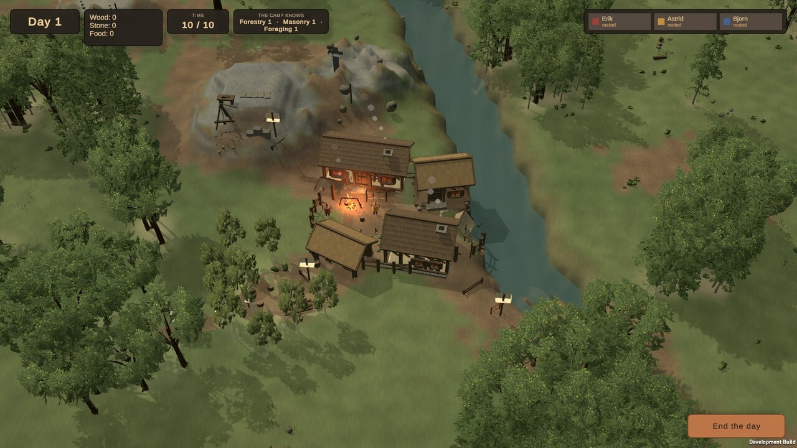
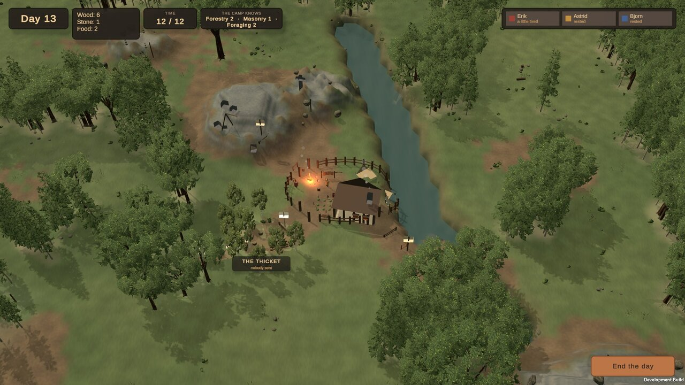

Welcome to my repo, almost everything is just vibecoded projects.

Most of what I build is private, so each project below has screenshots and a short tour to show what it does.

**Jump to:** [no-rake](#no-rake) · [job-autofill](#job-autofill) · [humble-beginnings](#humble-beginnings) · [gmail-calendar-sync](#gmail-calendar-sync) · [sleeper-fantasy](#sleeper-fantasy) · [insider-smells](#insider-smells) · [polytopia-plus](#polytopia-plus) · [sql-interview-prep](#sql-interview-prep)

---

## Private projects

### no-rake

Node · Fastify · WebSockets · React · Postgres · Railway &nbsp;|&nbsp; ~95% agent &nbsp;|&nbsp; <a href="https://no-rake-server-production.up.railway.app/">Play →</a>

Virtual Texas hold'em for friends and family, no real money. It started as "PokerNow, but with more features."

- Full no-limit hold'em from preflop to showdown, including side pots and all-in runouts
- Private rooms over WebSockets, host controls (adjust stacks, kick, move seats) and optional bots
- Every hand is saved: replay any hand street by street, see all-in EV, and export the ledger to CSV
- Automatic reconnection, with seats and stacks held temporarily after a dropped connection
- Custom auto-fold ranges with saved settings, touch and keyboard editing, undo, and a one-hand override
- CI runs client/server checks and Playwright critical-path tests on desktop Chromium, plus a mobile Chrome smoke test

Your turn on the flop, with the bet sizing panel open (captured against three bots)

---

### job-autofill

Chrome extension (Manifest V3) · TypeScript · esbuild · Playwright &nbsp;|&nbsp; ~95% agent

Fills job applications from a profile stored locally. It's designed to leave final application submission to you after review.

- Matches fields by label, placeholder, name and ARIA, with fixes for specific applicant tracking systems where the generic match fails
- Handles the awkward inputs: custom dropdowns, comboboxes, split phone fields and demographic questions
- After each fill, a review panel lists what was filled, what was skipped and what it's unsure about
- A review queue tracks job-alert links, flags repeat applications, and steps through supported forms before handing final submission back to me
- A searchable saved-answer library keeps earlier answers and revisions available for review and reuse
- Optional, editable AI drafts through OpenAI, with local profile storage and a local service for optional queue and writing-context features
- Tested against a library of saved application forms

A sample profile ("Jane Example") filling a test form built like a real Greenhouse application. 13 of 14 fields filled; the résumé shows as missed because none was loaded.

---

### humble-beginnings

Unity 6 · C# &nbsp;|&nbsp; ~95% agent

My first real game: a Unity prototype about growing a woodland homestead. The current development branch focuses on one founder gathering resources, building and improving skills in a 3D clearing.

- Gather wood, stone and food; manage a pack and depot
- Build a workbench, craft planks, upgrade your axe and repair a crossing
- Train Woodcutting, Mining and Crafting
- Continuous time with pause and save/load
- In development: illustrated character and inventory UI, plus woodland lighting, vegetation and stone polish
- Data-driven map authoring and Unity tools for scene builds, screenshots and testing

Settlement expansion and roguelike combat remain longer-term goals.

<table>
<tr>
<td width="50%"></td>
<td width="50%"></td>
</tr>
<tr>
<td align="center">The camp after it has grown into a cluster of longhouses</td>
<td align="center">Day 13, zoomed out over the valley</td>
</tr>
</table>

Earlier prototype screenshots (September 2026)

---

### gmail-calendar-sync

Node · Gmail API · Google Calendar API · OpenAI &nbsp;|&nbsp; ~95% agent

Built to turn inbox scheduling emails into calendar events and email a summary of changes.

- Handles calendar invites (ICS files), including updates and cancellations
- Picks up appointment emails that have no invite attached
- Package tracking: shipping emails become all-day delivery events that move when the ETA changes, using the live UPS tracking API
- An LLM reads personal and important threads and turns them into follow-ups and meetings, checking for an existing event first so nothing is added twice

The summary email, produced by the project's own formatter. The events are made-up sample data.

---

### sleeper-fantasy

React · TypeScript · Vite &nbsp;|&nbsp; ~95% agent

A local dashboard for my fantasy football team. It tells me which waiver claims and trades to make for my Sleeper league.

- Six tabs: Plan, Team, Waivers, Trades, Analysis and League
- Scores every trade and waiver claim by how many lineup points it adds over the rest of the regular season, using only legal lineups
- Averages expert rankings from FantasyPros, ESPN and RotoBaller, and runs seeded season simulations for playoff and title odds
- Read-only: it uses Sleeper's public API and can't submit anything. Saved inputs can be replayed offline to check any recommendation

---

### insider-smells

Python · uv · Postgres · Alembic · Railway &nbsp;|&nbsp; ~95% agent

Research tooling for Polymarket. The goal is to spot trading that looks coordinated or unusually well timed: who traded, how much, and how early.

- Streams live trades from Polymarket's market WebSocket and backfills historical fills from the public orderbook subgraph
- Stores everything in one Postgres database, removing duplicates, with versioned schema migrations
- A small password-protected dashboard confirms the data is flowing
- Next up: linking wallets, scoring timing and alerts. This is for research, not legal advice

---

### polytopia-plus

TypeScript · React · Three.js · Fastify · SQLite · Vitest &nbsp;|&nbsp; ~95% agent

A strategy game inspired by The Battle of Polytopia, for a private group of friends. It recreates the base game's rules and adds our own custom features.

- A rules engine that runs with no graphics and always gives the same result for the same moves, with content matched to the Steam v2.16.5 release
- Map generation, an invite-code lobby and online multiplayer where players take turns at their own pace, with the server deciding what's legal
- A 3D board built with Three.js, plus the tech tree, combat previews and a phone layout
- The current phase is visual polish: matching the original game's look, screenshot by screenshot

<table>
<tr>
<td width="50%"></td>
<td width="50%"></td>
</tr>
<tr>
<td align="center">The whole board on turn 20</td>
<td align="center">Previewing an attack: the defender would take 7 damage</td>
</tr>
</table>

---

### File Steward — Safer file management for AI agents

A Windows command-line tool that makes agent-assisted file management more inspectable. It scans selected folders, creates exact-file plans, and checks those plans for changed files and unsupported paths before any cleanup is considered.

- Read-only first release: Scan, Plan and Validate
- Human-readable reports and structured JSON for agent workflows
- Synthetic tests covering safety checks and failure cases
- Planned: approval-gated cache cleanup with an action log and recovery safeguards

Built with PowerShell. Early-stage project; cleanup execution is not enabled.

---

## Public projects

### sql-interview-prep

DuckDB · Python &nbsp;|&nbsp; ~70% agent &nbsp;|&nbsp; <a href="https://github.com/chensam93/sql-interview-prep">View repo →</a>

Interview-style SQL questions backed by DuckDB sample data. You run queries against real rows instead of whiteboarding on paper.
