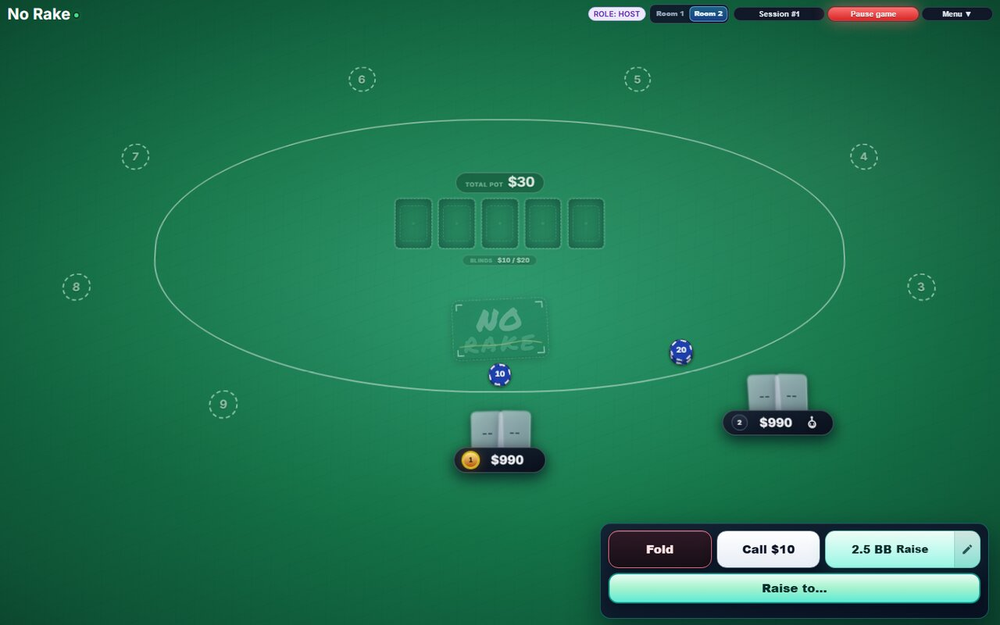
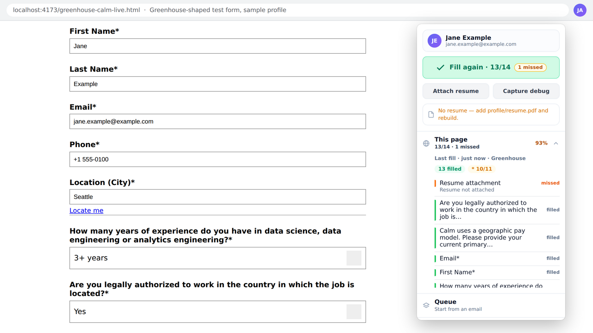
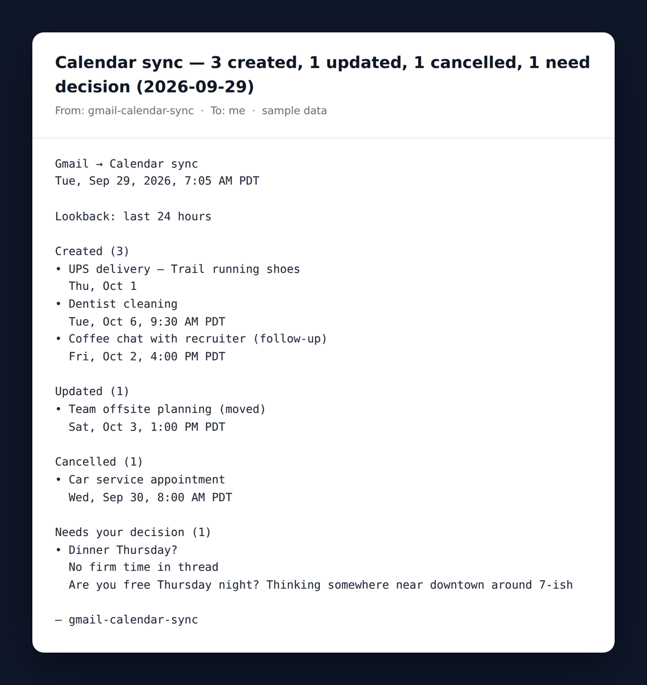
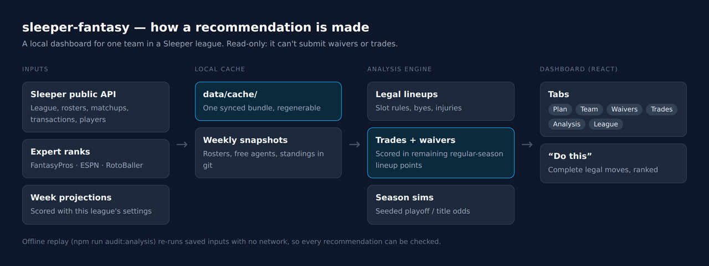
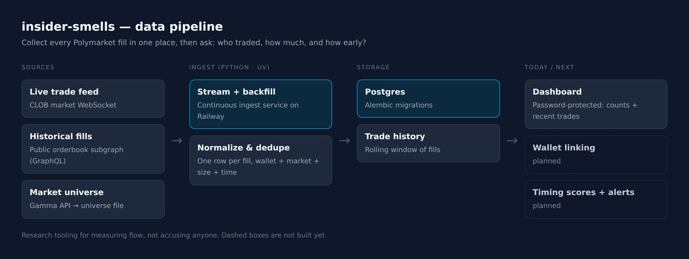
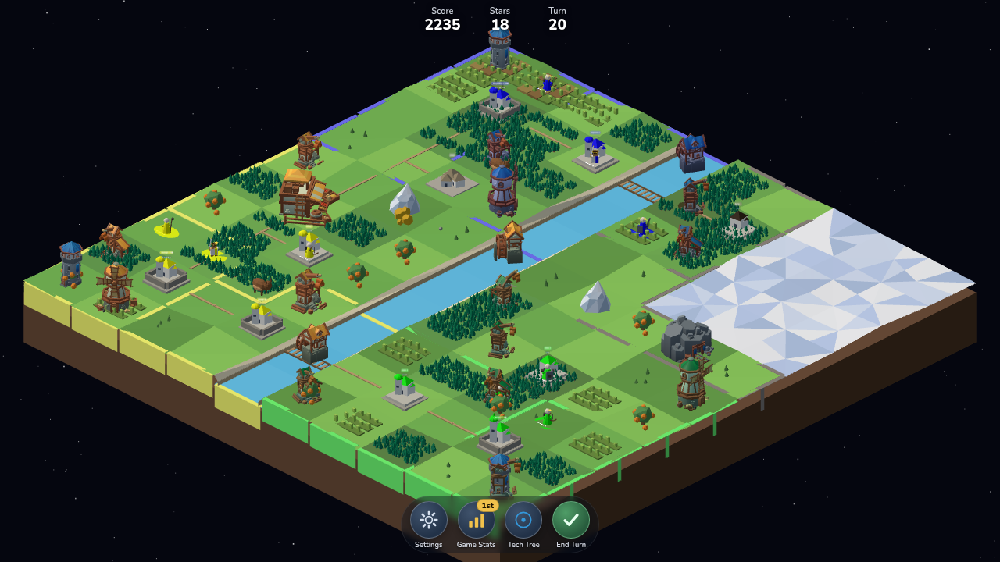
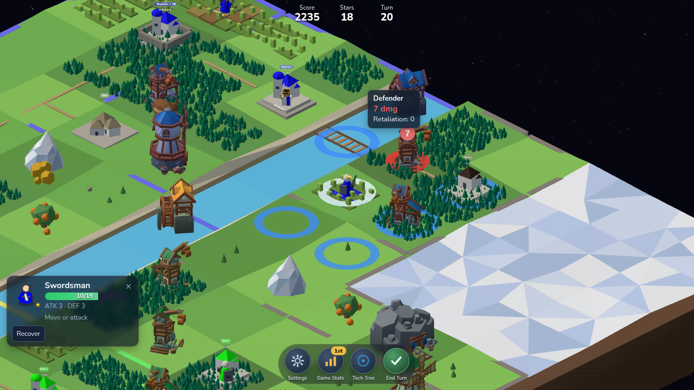

Welcome to my repo, almost everything is just vibecoded projects.

Most of what I build is private, so each project below has screenshots and a short tour to show what it does.

**Jump to:** [no-rake](#no-rake) · [job-autofill](#job-autofill) · [humble-beginnings](#humble-beginnings) · [gmail-calendar-sync](#gmail-calendar-sync) · [sleeper-fantasy](#sleeper-fantasy) · [insider-smells](#insider-smells) · [polytopia-plus](#polytopia-plus) · [sql-interview-prep](#sql-interview-prep)

---

## Private projects

### no-rake

Node · Fastify · WebSockets · React · Postgres · Railway &nbsp;|&nbsp; ~95% agent &nbsp;|&nbsp; <a href="https://no-rake-server-production.up.railway.app/">Live demo (temporarily unavailable) →</a>

Virtual Texas hold'em for friends and family, no real money. It started as "PokerNow, but with more features."

**Status:** The Railway-hosted live demo is temporarily unavailable.

- Private rooms over WebSockets, host controls and optional bots
- No-limit hold'em with side pots and all-in runouts; saved hands with replay, all-in EV and CSV exports
- Reconnection with seats and stacks held temporarily, plus custom auto-fold ranges
- CI runs client/server checks and Playwright critical-path tests on desktop Chromium, plus a mobile Chrome smoke test

Your turn on the flop, with the bet sizing panel open (captured against three bots)

---

### job-autofill

Chrome extension (Manifest V3) · TypeScript · esbuild · Playwright &nbsp;|&nbsp; ~95% agent

Fills job applications from a profile stored locally. It's designed to leave final application submission to you after review.

- Matches fields by label, placeholder, name and ARIA, with support for custom dropdowns, comboboxes and split phone fields
- Review results flag filled, skipped and uncertain fields; a searchable answer library supports reuse
- A job-link queue flags repeat applications and steps through supported forms for review
- Optional, editable OpenAI drafts, plus a local service for optional queue and writing-context features
- In development: AI-assisted question matching, named batches from links, tabs and emails, and results that refresh after manual edits

Tested against a library of saved application forms.

A sample profile ("Jane Example") filling a test form built like a real Greenhouse application. 13 of 14 fields filled; the résumé shows as missed because none was loaded.

---

### humble-beginnings

Unity 6 · C# &nbsp;|&nbsp; ~95% agent

My first real game: a Unity homestead prototype. On the development branch, one founder gathers resources, builds and develops skills in a 3D clearing.

- Gather resources, manage a pack and depot, craft planks, upgrade your axe and repair a crossing
- Train Woodcutting, Mining and Crafting, with continuous time, pause and save/load
- In development: updated founder movement and appearance, illustrated character and inventory UI, and woodland scenery
- Data-driven map authoring and Unity tools for scene builds, screenshots and testing

Settlement expansion and roguelike combat remain longer-term goals.

---

### gmail-calendar-sync

Node · Gmail API · Google Calendar API · OpenAI &nbsp;|&nbsp; ~95% agent

Built to turn scheduling emails into calendar events and send a summary of changes.

- Reads ICS invites, updates and cancellations, plus appointment emails without invites
- Creates all-day delivery events from shipping emails and updates ETAs through the UPS tracking API
- Uses an LLM to extract follow-ups and meetings, checking for existing events before adding them

The summary email, produced by the project's own formatter. The events are made-up sample data.

---

### sleeper-fantasy

React · TypeScript · Vite &nbsp;|&nbsp; ~95% agent

A local dashboard for my Sleeper league, recommending waiver claims and trades.

- Scores trades and waivers by added lineup points over the remaining regular season, using only legal lineups
- Expert rankings from FantasyPros, ESPN and RotoBaller, plus seeded simulations for playoff and title odds
- Read-only: uses Sleeper's public API, cannot submit actions, and can replay saved inputs offline

---

### insider-smells

Python · uv · Postgres · Alembic · Railway &nbsp;|&nbsp; ~95% agent

Research tooling for Polymarket, exploring coordinated or unusually timed trading.

- Streams market trades and backfills historical fills into deduplicated Postgres storage
- Versioned schema migrations and a password-protected data-flow dashboard
- Planned: linking wallets, timing scores and alerts

This is for research, not legal advice.

---

### polytopia-plus

TypeScript · React · Three.js · Fastify · SQLite · Vitest &nbsp;|&nbsp; ~95% agent

A strategy game inspired by The Battle of Polytopia, with custom features for a private group of friends.

- A deterministic rules engine with content matched to Steam v2.16.5
- Map generation, invite-code lobbies and asynchronous multiplayer with server-enforced rules
- Three.js board, tech tree, combat previews and phone layout
- Visual polish is ongoing, using screenshot comparisons with the original game

<table>
<tr>
<td width="50%"></td>
<td width="50%"></td>
</tr>
<tr>
<td align="center">The whole board on turn 20</td>
<td align="center">Previewing an attack: the defender would take 7 damage</td>
</tr>
</table>

---

### File Steward — Safer file management for AI agents

A read-only Windows PowerShell tool for agent-assisted file review. It scans selected folders, creates exact-file plans and checks for changed files or unsupported paths.

- Scan, Plan and Validate, with human-readable reports and structured JSON
- Synthetic tests covering safety checks and failure cases
- Planned: approval-gated cache cleanup with an action log and recovery safeguards

Early-stage; cleanup execution is not enabled.

---

## Public projects

### sql-interview-prep

DuckDB · Python &nbsp;|&nbsp; ~70% agent &nbsp;|&nbsp; <a href="https://github.com/chensam93/sql-interview-prep">View repo →</a>

Interview-style SQL questions you can run against DuckDB sample data.
